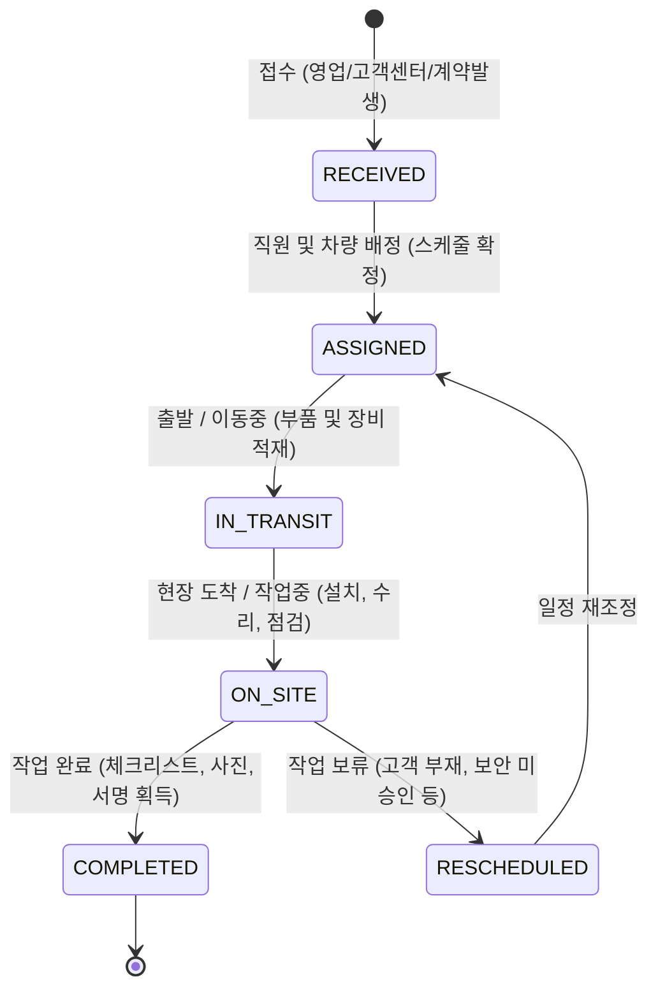

# e-Bro IT 렌탈 ERP 도메인 프로세스 및 아키텍처 정의서 (IT-rental.md)

---

## 1. 개요 및 IT 렌탈 비즈니스 원칙

본 문서는 `ebro_it` 시스템의 비즈니스 도메인, 프로세스, 데이터 스키마 및 운영 정책을 정의하는 **단일 진실의 원천(SSOT)**입니다.  
고소작업대(AWP) 중심의 중장비 렌탈 체계에서 출발하여, PC·노트북·서버·네트워크 등 **IT 하드웨어 렌탈 비즈니스의 고유한 현장 특성과 운영 실무**를 완벽히 반영하도록 재설계되었습니다.

### 1.1 최우선 개발 사명 및 핵심 가치 (전사 표준 헌장 준수)
1. **임직원의 최소 노력으로 최대 편익 창출**: 복잡한 중복 입력을 배제하고, 원클릭 상계 및 직관적 현장 업무 완결 지원.
2. **렌탈 자산 라이프사이클의 무결성**: 시리얼(S/N), MAC 주소, 실장 부품(RAM/SSD), 라이선스, 자산 상태(`AVAILABLE`, `RENTED`, `MAINTENANCE` 등)의 100% 추적성 보장.
3. **사건(Event) 기록의 무누락 DB 보존**: 계약 체결, 출고 검수, 배송/설치, 보증금 입금/상계/반환, AS 조치, 반납 검수 등 모든 비즈니스 이벤트의 감사 추적(Audit Trail) 확보.

### 1.2 전사 단일 표준 용어 정의 (One Term, One Meaning)
전사 표준 헌장 1.4에 의거하여, 다의어 및 동의어 파편화를 전면 배제하고 아래 단일 표준 용어만을 사용합니다:

| 표준 용어 (한글) | 표준 용어 (영문) | 정의 및 도메인 범위 | 금지/배제 표현 |
|---|---|---|---|
| **설치/납품처** | `CustomerSite` | 장비가 물리적으로 반입·설치·운용되는 고객사의 사업장, 지사, 센터, 전산실 등 | 현장, 고객현장, 공사현장 |
| **청구지** | `BillingTarget` | 전자세금계산서 수신 및 청구 마감이 통합 집행되는 본사/회계 단위 | 계산서발행처, 청구처 |
| **순 렌탈료** | `NetRentalFee` | 장비 자체의 순수 월/일 대여료 (운반설치비 미포함) | 임대료, 장비료, 월대료 |
| **운반설치비 등** | `DeliverySetupFee`| 초기 반입 운반 및 현장 기술 세팅에 대한 부대 청구액 (과금 또는 면제) | 운송비, 배차비, 톨비 |
| **보증금** | `Deposit` | 계약 이행 및 장비 멸실·훼손 담보 목적의 가수금(부채 계정) | 계약금, 선수금, 예치금 |
| **보증금 상계** | `DepositOffset` | 미납 청구액을 예치된 보증금 잔액에서 차감하여 수납 처리하는 행위 | 보증금차감, 대차상계 |
| **교환배송** | `Exchange` | 장애/노후 장비 대차 투입과 기존 장비 회수를 1건으로 묶어 처리하는 단일 업무 | 맞교환, 스왑, 대차 |
| **필드 엔지니어** | `FieldEngineer` | 자체 차량을 운전하여 배송, 설치, 회수, AS를 직접 수행하는 직영 직원 | 기사, 운송기사, 배차기사 |
| **자산번호** | `AssetNo` | IT 장비의 최우선 고유 키인덱스 (`yymmssss` 8자리 정수 채번 포맷) | 관리번호, 호기, 설비번호 |
| **임차 / 임차장비** | `RentedAsset` | 외부 타사/협력사로부터 임차하여 고객사에 공급 및 운용하는 장비 | 전대, 전대차, 전대장비, 서브리스 |

---

## 2. AWP 렌탈 vs IT 렌탈 패러다임 비교

IT 렌탈 비즈니스는 건설 중장비(AWP)와 비용 구조, 물류 형태, 기술 지원 측면에서 근본적인 차이가 존재합니다.

```
┌─────────────────────────────────────────────────────────────────────────────┐
│                              패러다임 근본 비교                             │
├──────────────────────────────────────┬──────────────────────────────────────┤
│          AWP (고소작업대/중장비)       │             IT (하드웨어/솔루션)     │
├──────────────────────────────────────┼──────────────────────────────────────┤
│ • 장비 중량 2톤~20톤의 대형 화물     │ • 박스/완제품 단위의 전자 통신 기기 │
│ • 전문 외부 화물 용차/추레라 필수 섭외│ • 자체 자가용 차량(스타렉스/탑차) 보유│
│ • 전체 비용 중 운송비 비중 20~40%    │ • 전체 비용 중 운송비 비중 극히 미미 │
│ • 운송사 건별 단가 네고 및 월말 정산 │ • 운송료 정산 무관 (내부 인건비/유류비)│
│ • 단순 상하차 운송 (기술 작업 없음)  │ • 배송 + 현장 세팅/설치 + AS 일체화  │
│ • 월말 1:1 운송료 대사가 필수 과제   │ • 직영 직원별 당일 배송/CS 스케줄이   │
│                                      │   운영의 최우선 핵심 과제            │
└──────────────────────────────────────┴──────────────────────────────────────┘
```

### 2.1 비용 구조 및 운송 관리 관심사의 전환
- **AWP**: 외부 화물 지입차주/운송주선사와의 단가 협상, 운송료 매입 세금계산서 대사, 기사별 지급 관리가 사활적.
- **IT**: 운송비는 단순 유류비/통행료 등 일반 관리비로 처리되며, 고객에게도 '운반설치비' 명목으로 정액 청구하거나 면제(무상 서비스)함. **외부 운송료 건별 처리 및 월말 운송료 대사는 시스템 관심사에서 제외**됨.

### 2.2 '배송 + 설치 + AS' 일체형 직영 체계
IT 렌탈의 핵심 역량은 장비를 문 앞에 내려놓는 것이 아니라, **"고객 업무 환경에 즉각 투입 가능하도록 완성하는 것"**에 있습니다:
1. **차량 적재 및 배송**: 직영 직원이 자가용 차량에 제품을 싣고 방문.
2. **현장 설치 (Setup)**: 전원 및 네트워크(LAN/Wi-Fi) 연결, 도메인/OS 계정 설정, 사내 프린터 드라이버 및 보안 솔루션 연동.
3. **유지보수 및 AS (CS)**: 부품 불량(RAM, SSD, 파워서플라이) 발생 시 현장 긴급 방문 점검 및 교체.
4. **회수 및 데이터 파기**: 계약 만료 시 물리적 철거, 포장 회수 및 저장매체(SSD/HDD) 데이터 영구 삭제/공장초기화 확인.

---

## 3. 제품(Product) 및 실물 자산(Asset) 체계

IT 장비는 표준 규격 모델(제품)과 실제 현장에 배치되는 개별 하드웨어(자산) 간의 스펙 가변성이 매우 높습니다.

```
┌─────────────────────────────────┐        1 : N         ┌─────────────────────────────────┐
│         제품 (Product)          │ ───────────────────> │          자산 (Asset)           │
├─────────────────────────────────┤                      ├─────────────────────────────────┤
│ • 모델명, 제조사, 카테고리       │                      │ • 고유 시리얼 번호 (S/N)        │
│ • CPU 기본 규격                 │                      │ • 유/무선 MAC 주소, IMEI        │
│ • RAM 확장 한계 (온보드+슬롯수) │                      │ • 실제 실장 RAM (예: 16G*2 32G)  │
│ • 스토리지 베이/슬롯 규격       │                      │ • 실제 실장 SSD (예: 1TB NVMe)  │
│ • 디스플레이/GPU 기본 탑재 사양 │                      │ • 실제 설치 OS 및 라이선스 키    │
│ • 모델별 표준 사진 (최대 4장)   │                      │ • 현재 자산 상태 (AVAILABLE 등) │
└─────────────────────────────────┘                      └─────────────────────────────────┘
```

### 3.1 10대 IT 표준 카테고리
1. `LAPTOP` (노트북 / 모바일 워크스테이션)
2. `DESKTOP` (데스크탑 / 미니PC / 타워)
3. `MONITOR` (사무용 / 4K 고해상도 / 울트라와이드 모니터)
4. `TV` (대형 디스플레이 / 전자칠판 / 회의실 사이니지)
5. `SERVER` (랙마운트 1U/2U/4U 서버 / 스토리지 NAS)
6. `NETWORK` (L2/L3 스위치, 라우터, 무선 AP, 방화벽)
7. `TABLET` (iPad, Galaxy Tab 등 태블릿 기기)
8. `PRINTER` (기업용 레이저 복합기 / 고속 프린터)
9. `SOFTWARE` (OS, 오피스, 백신, 그래픽 라이선스)
10. `OTHER` (도킹스테이션, 모니터암, KVM, 주변기기)

### 3.2 제품(Product) vs 실물 자산(Asset) 속성 분리 원칙
- **제품 (`products`)**: 기종 고유의 아키텍처 및 업그레이드 확장 상한선 정의
  - CPU, RAM 아키텍처(`onboardRam`, `ramSlots`, `maxRam`, `baseRam`), 스토리지 베이 규격(`storageSlots`, `storageFormFactors`), GPU 규격(`gpuType`, `defaultGpu`), 디스플레이 사양.
  - **표준 사진 자료 (최대 4장)**: `FRONT`(전면), `REAR`(후면), `INSIDE`(내부), `OTHER`(기타/포트/번들).
- **실물 자산 (`assets`)**: 시리얼 기반 취득 후 가변 개조된 현재 물리적 실장 사양
  - `serialNo`, `wiredMac`, `wifiMac`, `imei`.
  - `ramConfig` (예: `16GB (8GB*2)` vs `32GB (16GB*2)`), `storageDrives` (장착된 실물 드라이브 목록).
  - `installedGpu`, `installedOs`, `licenseKey`, `licenseExpiryDate`.

### 3.3 자산번호(Asset No) 단일 핵심 인덱스 및 표준 채번 규칙 (`yymmssss`)
- **관리번호 완전 폐기 원칙 (AWP 호기 체계 탈피)**:
  - 건설장비(AWP)에서는 '관리번호(호기)'가 장비 식별의 중심이었으나, **IT 렌탈 ERP에서는 '관리번호'라는 용어 및 체계를 일절 사용하지 않습니다**.
  - 자산 등록/취득, 계약 체결, 출고 검수, 배송/설치, 반납/회수, 정비, 매각, 임차 대사 등 시스템 전 영역에서 **오직 '자산번호 (`assetNo`)' 단 하나만을 핵심 고유 키인덱스로 통합 운용**합니다.
- **표준 채번 규칙 (`yymmssss`)**:
  - 취득일자(또는 등록일자) 기준: **연도 2자리(`yy`) + 월 2자리(`mm`) + 4자리 일련번호(`ssss`)**의 총 8자리 정수 포맷.
  - 예시:
    - `2026년 10월` 첫 번째 등록 자산: `26100001`
    - `2026년 10월` 두 번째 등록 자산: `26100002`
    - `2026년 11월` 첫 번째 등록 자산: `26110001` (월 변경 시 일련번호 `0001`부터 자동 리셋)
  - **다중 일괄 등록(N대) 시 자동 순차 채번**:
    - 취득 스튜디오 및 대량 슬롯 추가 시 기준 자산번호로부터 N대가 1씩 자동 증가하여 중복/충돌 없이 순차 채번됩니다.

### 3.4 외부 타사 장비 조달: "임차" 단일 명칭 표준화 ("전대" 용어 전면 배제)
- **1단어 1뜻 표준화 원칙 (전사 표준 헌장 1.4 준수)**:
  - 중장비 도메인에서 관행적으로 혼용되던 **'전대(Sublease)', '전대차', '전대장비' 명칭을 IT 도메인에서는 전면 배제**합니다.
  - 시스템 전반(메뉴, 탭, 버튼, 통계, DB 컬럼 코멘트)에서 오직 **'임차', '임차장비', '임차처'** 단일 표준 명칭만을 사용합니다.
- **임차 자산의 자사 자산번호 부여 및 1:1 정밀 대사**:
  - 외부 벤더사로부터 조달한 임차 장비 또한 자사의 `yymmssss` 자산번호 체계로 채번되어 자산대장에 등록됩니다.
  - 원 벤더사의 관리번호는 `vendorAssetNo (임차처 자산번호)` 보조 필드로만 무누락 보존됩니다.
  - 월말 매입 명세서 대사 시에는 시리얼번호가 아닌 **자사의 자산번호(`assetNo`)를 최우선 기준으로 O(1) 정밀 교차 검증**을 집행합니다.

---

## 4. 고객사, 청구지 및 설치/납품처 체계

IT 렌탈은 **"마감/청구는 본사 총괄, 장비는 전국 각 사업장/지사로 분산 반입"**되는 전형적인 엔터프라이즈 구조를 가집니다.

```
┌────────────────────────────────────────────────────────────────────────┐
│                        고객사 본사 (Customer)                           │
│  • 고객사 기본 정보 및 신용 관리                                       │
│  • 통합 청구지 목록 (billingTargets: 본사재경팀, 강남지사 등)          │
└───────────────────────────────────┬────────────────────────────────────┘
                                    │ 1 : N
        ┌───────────────────────────┴───────────────────────────┐
        ▼                                                       ▼
┌──────────────────────────────┐        ┌──────────────────────────────┐
│  설치/납품처 A (판교 R&D센터) │        │   설치/납품처 B (여의도 금융) │
├──────────────────────────────┤        ├──────────────────────────────┤
│ • 상세위치: 8층 서버실       │        │ • 상세위치: 12층 개발실      │
│ • 수령부서: 인프라운영팀     │        │ • 수령부서: 핀테크개발팀     │
│ • 보안출입: 사전등록 필수    │        │ • 보안출입: 신분증 지참      │
│ • 엘리베이터: 화물용보유     │        │ • 엘리베이터: 일반승강기     │
│ • 추천배송: 엔지니어 직배송  │        │ • 추천배송: 엔지니어 직배송  │
└──────────────────────────────┘        └──────────────────────────────┘
```

### 4.1 고객사 레벨: 본사 통합 청구지 (`billingTargets`)
- IT 임대업은 개별 지점 단위 마감이 아닌, 고객사 본사 재경팀에서 전자세금계산서 수취 및 대금 결제를 총괄 집행합니다.
- `customers.billingTargets` JSONB 배열로 복수의 계산서 발행 단위(본사, 특정 사업부, 자회사 등)를 관리합니다:
  - `targetName`, `taxEmail`, `contactName`, `contactPhone`, `subBizNo`.

### 4.2 설치/납품처 레벨 (`CustomerSite`): 물리적 반입 인프라
- 기존 공사현장 개념의 "현장" 명칭을 완전 배제하고, IT 거점 인프라 8대 필드를 필수 관리합니다:
  1. `addressDetail`: 건물 층수, 호실, 전산실 랙 번호 등 상세 위치.
  2. `department`: 실제 장비를 인도받을 부서명.
  3. `contactName`, `contactPhone`: 수령 실무 담당자 정보.
  4. `deliveryMethod`: 기본 권장 배송/설치 수단.
  5. `hasFreightElevator`: 대형 랙/서버/다량 PC 반입용 화물 엘리베이터 유무.
  6. `requiresSecurityPass`: 사전 방문객/차량 보안 등록 필요 여부.
  7. `accessNotes`: 지하 하역장 층수, 신분증 지참 등 출입 주의사항.

---

## 5. 계약(Contract) 및 과금 체계

### 5.1 1계약 = 1청구지, 1설치/납품처 단일 귀속 원칙
- 1건의 계약은 반드시 단 하나의 청구지(`billingTargetSeq`)와 단 하나의 설치/납품처(`siteId`)에 직결됩니다.
- 설치 장소가 다른 장비는 별도의 계약으로 분리하여, 배송·설치 일정 관리와 분실·회수 추적의 혼선을 원천 방어합니다.

### 5.2 계약 기간 유형 (하이브리드 지원)
- **단기 렌탈 (`SHORT_TERM`)**: 행사, 팝업스토어, 감사, 프로젝트성 대여 (일/주/월 단위, 일할 계산 적용).
- **장기 약정 (`LONG_TERM`)**: 12/24/36/48개월 단위 정기 임대 (약정 할인율, 중도해지 위약금율, 보증금 조건 적용).

### 5.3 비용 구조 분리
$$\text{월 청구액} = \text{순 렌탈료(Net Rental Fee)} + \text{운반설치비 등(Delivery Setup Fee)}$$
- 장비의 순수 렌탈료와 초기 반입/세팅 부대비용을 명확히 구분하여 계약서 및 청구서에 표기합니다.
- 운반설치비는 회사 정책 또는 프로모션에 따라 `0원(면제)` 처리할 수 있습니다.

### 5.4 IT 5대 배송 수단
1. `DIRECT_INSTALL` (엔지니어 직배송/설치) - **IT 도메인의 표준(Default)**
2. `COURIER` (택배 발송 - 소량 노트북/부품)
3. `QUICK` (오토바이/다마스 퀵서비스 - 긴급 부품/교환)
4. `FREIGHT` (화물 용차 - 대형 서버랙/전산실 이전 시 외주 섭외)
5. `PICKUP` (고객사 담당자 직접 방문 수령/반납)

---

## 6. 보증금(가수금) 라이프사이클 및 수납/상계 프로세스

IT 고가 장비 대여 시 계약 불이행, 대금 연체, 장비 미반환/파손을 담보하기 위해 **가수금 형태의 보증금**을 예치받습니다.

```
┌────────────────────────────────────────────────────────────────────────┐
│                        보증금 라이프사이클 흐름                         │
├────────────────────────────────────────────────────────────────────────┤
│ [계약 체결] ──> 약정액 설정 (depositStatus: 'UNPAID', balance: 0)       │
│      │                                                                 │
│      ▼ [통장 입금 확인]                                                │
│ [보관 단계] ──> 가용 잔액 활성화 (depositStatus: 'HELD', balance: 약정액)│
│      │                                                                 │
│      ├─ [월별 수납 시 선택적 상계]                                     │
│      │   └──> depositStatus: 'PARTIAL_OFFSET' (잔액 실시간 차감)       │
│      │                                                                 │
│      ▼ [계약 종료 시점 원스톱 최종정산]                                │
│ [최종 정산] ──> 미납 청구 FIFO 자동 순차 상계 (payments: 'DEPOSIT_OFFSET')│
│      │                                                                 │
│      ▼                                                                 │
│ [완료/환급] ──> 잔여 보증금 환급 계좌 송금 처리 (depositStatus: 'REFUNDED')│
│                 계약 상태 'COMPLETED'로 종결                           │
└────────────────────────────────────────────────────────────────────────┘
```

### 6.1 회계적 분리 원칙: 보증금 vs 선수금
- **선수금 (`prepaidBalance`)**: 고객이 미리 납부한 렌탈료. 익월 청구서 발행 시 자동으로 최우선 차감되는 '수익 전입 예정 부채'.
- **보증금 (`depositBalance`)**: 계약 담보용 가수금. **정기 청구서 발행 시 자동 차감되지 않으며**, 아래 두 가지 경우에만 명시적으로 사용됨:
  1. 월별 수납 시 담당자가 `[보증금 상계 (Tab)]`을 선택하여 차감 승인할 때.
  2. 계약 종료 시 미납 청구액을 최종 반제하고 남은 잔액을 반환할 때.

### 6.2 보증금 5대 상태 머신
1. `UNPAID` (미입금): 계약 체결 후 보증금 입금 대기 상태.
2. `HELD` (보관중): 통장 입금 확인 완료, 보증금 가용 잔액 전액 보유 상태.
3. `PARTIAL_OFFSET` (일부상계): 월별 수납 중 일부가 보증금으로 상계되어 잔액이 일부 남아있는 상태.
4. `FULLY_OFFSET` (전액상계): 미납 청구 반제로 인해 보증금 잔액이 0원이 된 상태.
5. `REFUNDED` (반환완료): 계약 종료 시 미납액 정산 후 남은 잔여 보증금을 고객 계좌로 환급 송금 완료한 상태.

### 6.3 수납 단계 복합 수납 및 우선 반제 정책
- **평상시 수납**: 매월 청구액은 **통장 입금액 또는 법인카드로 우선 반제**하는 것을 기본 원칙으로 함.
- **복합 수납(통장입금 + 보증금 일부 상계)**:
  - 통장 입금액이 부족하거나 고객 요청 시, 수납 모달의 `[보증금 상계]` 탭에서 가용 보증금 한도 내 지정 금액을 상계 처리 (`payments.method = 'DEPOSIT_OFFSET'`).
  - 상계된 금액만큼 계약의 `depositBalance`가 즉시 차감됨.

### 6.4 계약 종료 시점 원스톱 최종정산 수식
$$\text{상계 가능액} = \min(\text{가용 보증금 잔액}, \text{계약 미납 청구 총액})$$
$$\text{고객 반환액(환급액)} = \text{가용 보증금 잔액} - \text{상계 가능액}$$
$$\text{상계 후 최종 미납 잔액} = \text{계약 미납 청구 총액} - \text{상계 가능액}$$

1. 발생일자가 오래된 미납 청구서부터 순차적(FIFO)으로 `DEPOSIT_OFFSET` 수납 전표 자동 생성.
2. 미납 청구가 전액 해소되고 남은 보증금은 등록된 고객사 환급 계좌로 송금 처리 기록.
3. 보증금으로도 미납이 다 해소되지 못할 경우, 남은 미납액은 채권 추심 대상으로 잔존하며 계약은 최종 정산 상태로 마감.

---

## 7. 직영 차량 기반 배송/CS 통합 관리 체계 (핵심 아키텍처)

IT 렌탈 비즈니스의 현장 운영 핵심은 외부 화물 용차 단가 대사가 아니라, **"당일 발생하는 다양한 기술 지원 및 배송 요구를 복수의 직영 직원 중 누가, 어떤 차량으로, 어느 동선으로 처리할 것인가"**를 중앙에서 실시간 조율하는 것입니다.

```
┌─────────────────────────────────────────────────────────────────────────────┐
│                    당일 직영 배송/CS 스케줄 및 배정 보드                    │
├─────────────────────────────────────────────────────────────────────────────┤
│  [발생 티켓 풀]                                                             │
│  • [출고] (주)카카오 판교 8층 - PC 20대 신규 설치 (희망 10:00)              │
│  • [AS]   네이버 분당 5층 - ThinkPad 메인보드 불량 방문점검 (희망 11:30)    │
│  • [교환] 토스 강남 12층 - 맥북 침수 장애 긴급 맞교환 (희망 14:00)         │
│  • [회수] 쿠팡 송파 3층 - 단기 프로젝트 종료 모니터 10대 철거 (희망 16:00) │
├─────────────────────────────────────────────────────────────────────────────┤
│  [직영 엔지니어 및 차량 배정 현황 (타임라인/칸반)]                          │
│                                                                             │
│  🚗 스타렉스 1호 (김엔지니어) ── [판교 출고설치 10:00] ──> [분당 AS 11:30]  │
│  🚙 카니발 2호   (이엔지니어) ── [강남 교환배송 14:00] ──> [송파 회수 16:00]│
│  🚚 1톤 탑차 3호 (박엔지니어) ── [여의도 서버랙 이전 대규모 출고 지원]      │
└─────────────────────────────────────────────────────────────────────────────┘
```

### 7.1 4대 필드 업무 티켓 (Field Tickets)
현장에서 발생하는 모든 출장 업무는 아래 4대 티켓으로 표준화 분류됩니다:

| 티켓 유형 | 영문 코드 | 발생 원인 및 업무 내용 | 현장 작업 내역 |
|---|---|---|---|
| **출고배송 (신규 설치)** | `OUTBOUND_INSTALL` | 계약 체결 및 증설에 따른 신규 기기 납품 | 하역, 자리 배치, 전원/LAN 결선, 부팅 검수, 수령 서명 |
| **회수배송 (철거)** | `INBOUND_RETRIEVAL` | 계약 만료, 중도 해지, 부분 반납 | 외관 파손 점검, 데이터 삭제 확인, 박스 포장, 적재 회수 |
| **교환배송 (맞교환)** | `EXCHANGE_DELIVERY` | 사용 중 기기 고장, 스펙 변경으로 인한 대차 | 신규 장비 인도 및 설치 + 고장 장비 즉시 회수 (1타임) |
| **AS방문 요청 (CS/점검)**| `ONSITE_MAINTENANCE`| 부품 고장, OS 오류, 네트워크 장애 접수 | 현장 분해 점검, RAM/SSD/파워 교체, 소프트웨어 재설정 |

### 7.2 업무 라이프사이클 상태 머신 (Field Ticket Lifecycle)



1. **접수 (`RECEIVED`)**:
   - 영업 계약 출고, 고객사 CS 문의, 정기 예방점검을 통해 티켓 자동/수기 생성.
   - 필수 정보: 고객사, 설치/납품처(층수/상세위치), 수령자 연락처, 보안출입 주의사항, 방문 희망 일시.
2. **배정 (`ASSIGNED`)**:
   - 관리자가 일일 배송/CS 보드에서 **담당 엔지니어와 차량**을 지정.
   - 인근 지역(권역별: 강남권, 판교/분당권, 여의도/마포권 등) 동선을 묶어 배정.
3. **출발/이동 (`IN_TRANSIT`)**:
   - 엔지니어가 차량에 장비/부품을 싣고 고객사로 이동 개시. 고객사 담당자에게 도착 예정 시간 안내 발송.
4. **현장 작업 (`ON_SITE`)**:
   - 설치/세팅, 부품 교체, 장애 해결 등 실무 기술 지원 수행.
5. **완결 (`COMPLETED`)**:
   - 현장 체크리스트 체크, 설치 완료 사진 촬영, 고객 수령 서명(전자서명) 획득 ➔ 모바일 원클릭 승인.
   - 시스템 자산 상태 실시간 동기화 (`RENTED`, `AVAILABLE` 등).

### 7.3 자가용 운송 차량 및 직영 인력 풀 관리
- **자가용 차량 풀 (`company_vehicles`)**:
  - 관리 항목: 차량번호, 차종(스타렉스, 카니발, 1톤 탑차, 경차 등), 전담 운전자, 적재 용량(PC 최대 적재 수량), 정기 검사일, 유류 카드 정보.
- **직영 엔지니어 풀**:
  - 관리 항목: 성명, 연락처, 보유 기술 자격(네트워크, 서버, 하드웨어), 당일 배정 현황(작업 건수, 현재 상태).

### 7.4 현장 완료 보고 및 증적 관리 (Audit Trail)
- **설치 완료 사진**: 기기 전원 인가 화면, 책상 배치 상태, 시리얼 번호 바코드 라벨 사진 (최대 4장).
- **기술 점검 체크리스트**:
  - [x] 전원 및 윈도우/OS 정상 부팅 확인
  - [x] 사내 유/무선 네트워크 연결 및 IP 할당 확인
  - [x] 사전 요청 부품(RAM/SSD) 실장 용량 일치 확인
  - [x] 외관 스크래치 및 디스플레이 결점 유무 확인
- **고객 인수 서명**: 고객 담당자의 전자 서명 패드 서명 데이터 보존.

---

## 8. 화면 아키텍처 개편 명세: `TruckDispatch` ➔ `배송/CS 관리`

기존의 고소작업대 전용 화물 운송료 대사 화면을 폐기하고, IT 렌탈 전용 **"배송/CS 관리 스튜디오"**로 화면을 개편합니다.

```
┌─────────────────────────────────────────────────────────────────────────────┐
│ 탭 1: 당일 배송/CS 스케줄 및 배정 보드 (타임라인 / 칸반 뷰)                 │
├─────────────────────────────────────────────────────────────────────────────┤
│ • 좌상단: 조회 일자(오늘, 내일, 주간), 권역 필터, 미배정 티켓 카운터        │
│ • 중앙 본문: 직영 직원별 타임라인 그리드 (누가 몇 시에 어디로 이동하는가)   │
│ • 드래그 앤 드롭 또는 원클릭 직원/차량 배정 모달                            │
│ • 인라인 상태 변경: [출발] ➔ [현장도착] ➔ [완료보고]                        │
├─────────────────────────────────────────────────────────────────────────────┤
│ 탭 2: 배송/CS 처리 대장 및 완료 검증 (고밀도 그리드 뷰)                    │
├─────────────────────────────────────────────────────────────────────────────┤
│ • (구) 화물 운송료 대사 탭 완전 제거 ➔ 배송/CS 수행 이력 대장으로 전환     │
│ • 일자별, 고객사별, 엔지니어별 필터링                                       │
│ • 티켓 유형(출고, 회수, 교환, AS), 설치처, 작업 시간, 완료 사진 및 서명 열람 │
│ • 엑셀 내보내기 지원 (월간 서비스 수행 보고서 산출)                        │
└─────────────────────────────────────────────────────────────────────────────┘
```

---

## 9. 데이터베이스 스키마 설계 (DDL 명세)

### 9.1 필드 서비스 티켓 테이블 (`field_service_tickets`)
```sql
CREATE TABLE IF NOT EXISTS public.field_service_tickets (
    id UUID PRIMARY KEY DEFAULT gen_random_uuid(),
    tenant_id TEXT NOT NULL,
    ticket_no TEXT UNIQUE NOT NULL,              -- 티켓번호 (예: TK-261019-001)
    ticket_type TEXT NOT NULL,                   -- OUTBOUND_INSTALL, INBOUND_RETRIEVAL, EXCHANGE_DELIVERY, ONSITE_MAINTENANCE
    status TEXT NOT NULL DEFAULT 'RECEIVED',     -- RECEIVED, ASSIGNED, IN_TRANSIT, ON_SITE, COMPLETED, CANCELLED
    
    contract_id UUID REFERENCES public.contracts(id) ON DELETE SET NULL,
    customer_id UUID REFERENCES public.customers(id) ON DELETE CASCADE,
    site_id UUID REFERENCES public.customer_sites(id) ON DELETE SET NULL,
    
    -- 일정 및 배정
    scheduled_date DATE NOT NULL,                -- 방문 예정일
    scheduled_time_slot TEXT,                    -- AM, PM, 14:00 등
    assigned_engineer_id UUID,                   -- 배정 엔지니어 (users.id)
    assigned_engineer_name TEXT,
    assigned_vehicle_id UUID,                    -- 배정 자가용 차량
    assigned_vehicle_no TEXT,
    
    -- 현장 상세
    site_address_snapshot TEXT,                  -- 방문지 주소
    site_detail_snapshot TEXT,                   -- 상세위치 (8층 전산실 등)
    recipient_name TEXT,                         -- 현장 수령자명
    recipient_phone TEXT,                        -- 현장 수령자 연락처
    security_notes TEXT,                         -- 보안출입 주의사항
    task_description TEXT,                       -- 작업 내용 상세 (예: ThinkPad T14 5대 설치 및 고품 1대 회수)
    
    -- 완결 증적
    completed_at TIMESTAMPTZ,
    checklist_data JSONB DEFAULT '{}'::jsonb,    -- 완료 체크리스트
    completion_photos JSONB DEFAULT '[]'::jsonb, -- 현장 사진 (최대 4장)
    customer_signature_url TEXT,                 -- 고객 전자서명 이미지 URL
    completion_notes TEXT,                       -- 엔지니어 특이사항 메모
    
    created_at TIMESTAMPTZ DEFAULT now(),
    updated_at TIMESTAMPTZ DEFAULT now()
);

CREATE INDEX idx_fst_date_status ON public.field_service_tickets(scheduled_date, status);
CREATE INDEX idx_fst_engineer ON public.field_service_tickets(assigned_engineer_id);
```

### 9.2 회사 자가용 차량 테이블 (`company_vehicles`)
```sql
CREATE TABLE IF NOT EXISTS public.company_vehicles (
    id UUID PRIMARY KEY DEFAULT gen_random_uuid(),
    tenant_id TEXT NOT NULL,
    vehicle_no TEXT UNIQUE NOT NULL,             -- 차량번호 (예: 12가 3456)
    model_name TEXT NOT NULL,                    -- 스타렉스 3밴, 카니발 9인승, 1톤 탑차 등
    capacity_description TEXT,                   -- 적재 가능 규모 (예: 데스크탑 15세트 or 랙마운트 2대)
    primary_driver_id UUID,                      -- 기본 지정 전담 엔지니어
    is_active BOOLEAN DEFAULT true,
    fuel_card_no TEXT,
    last_inspection_date DATE,
    created_at TIMESTAMPTZ DEFAULT now()
);
```

---

## 10. 결론 및 향후 구현 체크리스트

본 설계서는 IT 하드웨어 렌탈 비즈니스의 현장 본질을 정확히 반영하여 시스템을 최적화하기 위한 핵심 지침입니다:

- [x] **고객/청구지/설치처 체계 확립**: 본사 청구지(`billingTargets`)와 거점 인프라 8개 필드 완성.
- [x] **현장별 옵션 관리 전면 제거**: 건설장비(AWP) 전용인 "현장별 옵션 관리(`site_options`)" 메뉴 및 컴포넌트를 100% 완전 제거하고, IT 인프라 환경은 설치처(`CustomerSite`)에 직접 직결.
- [x] **IT 제품/자산 스펙 분리**: 10대 카테고리, 제품 기본 제원 vs 자산 실장 제원 및 4장 표준 사진 연동.
- [x] **보증금(가수금) 라이프사이클 완성**: 통장 입금 연동 ➔ 수납 단계 상계 ➔ 계약 종료 시 원스톱 최종정산.
- [ ] **배송/CS 관리 스튜디오 신설 (`TruckDispatch.tsx` 개편)**:
  - 구버전 외부 화물 운송료 대사(Tab 2) 제거.
  - 당일 직영 엔지니어/차량 스케줄 보드(Tab 1) 및 배송/CS 처리 대장(Tab 2) 구현.
  - 4대 필드 업무 티켓(`OUTBOUND_INSTALL`, `INBOUND_RETRIEVAL`, `EXCHANGE_DELIVERY`, `ONSITE_MAINTENANCE`) 풀 및 배정 로직 장착.
  - 현장 완료 보고 모달(체크리스트, 사진, 서명) 구현.

---

## 11. 건설장비(AWP) 전용 기능의 제거: 현장별 옵션 관리 전면 배제

### 11.1 제거 배경 및 도메인 원칙
1. **건설현장 옵션과의 무관성**:
   - AWP는 건설현장별로 비산방지망, 협착방지봉, 안전센서, 무논마스킹 등 물리적 안전옵션 규격이 필수적이었으나, IT 하드웨어(PC/노트북/서버)는 이러한 건설 안전 옵션이 전무함.
2. **설치 환경의 차이**:
   - IT 렌탈의 설치 환경(전산실 랙 유닛 수, 전원 규격, 엘리베이터 유무, 바닥 단차 등)은 물리적 장비 부착 옵션이 아니라 **고객사 설치처(`CustomerSite`)의 환경 스펙**으로 관리됨.
3. **메뉴 및 UI 전면 제거**:
   - `site_options` 메뉴, `SiteOptionManage.tsx` 파일, 역할별 권한 템플릿, 네비게이션 링크, 중앙 플랫폼 DB의 `allowedPages`에서 일체 제거 완료.
